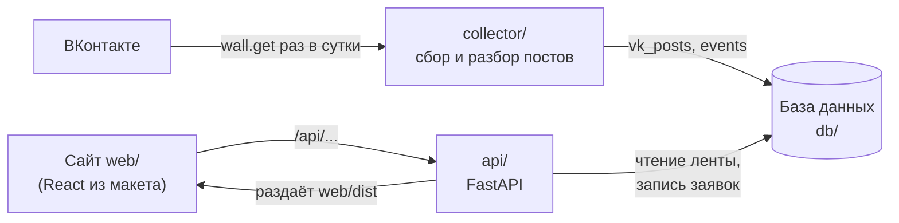

# API календаря мероприятий

Какие запросы принимает API, что отвечает и как подключить к нему фронтенд из макета. Живое описание со схемами ответов открывается на http://127.0.0.1:8000/docs, когда запущен сервер. Поля мероприятия — в [event_format.md](event_format.md).

## 1. Место API в системе



Сборщик и сайт общаются только через базу. API никогда не обращается к ВКонтакте.

## 2. Запросы

| Метод и адрес           | Что делает                                         | Ответ                    | Ошибки       |
| ----------------------- | -------------------------------------------------- | ------------------------ | ------------ |
| `GET /api/events`       | Лента, фильтр, поиск и календарь — параметры ниже  | `200` — страница ленты   | `422`        |
| `GET /api/events/{id}`  | Одно мероприятие                                   | `200` — мероприятие      | `404`, `422` |
| `GET /api/categories`   | Все категории с числом мероприятий в ленте         | `200` — список           | —            |
| `POST /api/submissions` | Заявка из формы «Подать мероприятие»               | `201` — номер заявки     | `422`        |
| `GET /api/health`       | API и база работают (для проверки после размещения) | `200` `{"status": "ok"}` | `503`        |

Параметры `GET /api/events`, все необязательные:

| Параметр    | Пример       | Что делает                                                                                   |
| ----------- | ------------ | -------------------------------------------------------------------------------------------- |
| `category`  | `sport`      | Код категории из `event_format.md`. Неизвестный код — пустая лента                           |
| `date_from` | `2026-11-01` | Мероприятия, которые идут в этот день или позже. Без параметра — с сегодняшнего дня по Томску |
| `date_to`   | `2026-11-30` | Мероприятия, которые начинаются не позже этого дня                                           |
| `q`         | `турнир`     | Подстрока в названии или описании, без учёта регистра, до 100 символов                       |
| `page`      | `2`          | Номер страницы, с 1                                                                          |
| `per_page`  | `100`        | Сколько мероприятий на странице, от 1 до 100. По умолчанию 20                                |

## 3. Какие мероприятия видны

Условия, которые API добавляет к каждому запросу ленты:

- `status = published`, у мероприятия есть дата и категория;
- последний день (`end_date`, а если её нет — `event_date`) не раньше сегодняшнего или `date_from`. Многодневное мероприятие, которое началось вчера и закончится завтра, остаётся в ленте;
- сортировка: дата, затем время (мероприятия без времени — в конце дня), затем `id`.

| Мероприятие               | В ленте                      | `GET /api/events/{id}` | В счётчиках категорий |
| ------------------------- | ---------------------------- | ---------------------- | --------------------- |
| `published`, не прошло    | да                           | да                     | да                    |
| `published`, прошло       | только при явном `date_from` | да                     | нет                   |
| `pending`, `rejected`     | нет                          | `404`                  | нет                   |
| без даты или категории    | нет                          | `404`                  | нет                   |

«Сегодня» считается по Томску (UTC+7), даже если сервер работает по UTC.

## 4. Ответы

`GET /api/events`:

```json
{
  "items": [
    {
      "id": 1,
      "title": "Мастер-класс по алтимату",
      "organizer": "Спортклуб «Сибирские львы»",
      "category": { "slug": "sport", "name": "Спорт" },
      "source": "vk",
      "event_date": "2026-11-13",
      "end_date": null,
      "start_time": "18:00",
      "end_time": null,
      "location": "ул. Карпова, 4",
      "original_post_link": "https://vk.com/wall-44845822_52494"
    }
  ],
  "page": 1,
  "per_page": 20,
  "total": 1
}
```

`GET /api/events/{id}` — те же поля плюс `description` и `image_url`.

`GET /api/categories` — все шесть категорий в порядке из `event_format.md`, в том числе с нулём:

```json
[
  { "slug": "sport", "name": "Спорт", "events_count": 2 },
  { "slug": "science", "name": "Наука", "events_count": 0 }
]
```

Время всегда в виде `"18:00"` или `null`, а не `"00:00"`. Поле `contact` не попадает ни в один ответ.

## 5. Заявка из формы

`POST /api/submissions`:

```json
{
  "title": "Субботник «Чистый берег»",
  "organizer": "Волонтёрский центр ТПУ",
  "contact": "volunteers@example.com",
  "category": "volunteering",
  "event_date": "2026-11-15",
  "start_time": "11:00",
  "end_time": "14:00",
  "location": "Набережная реки Ушайки",
  "original_post_link": "",
  "description": "Берём перчатки и мешки, чай после уборки."
}
```

Ответ `201`: `{ "id": 12, "status": "pending" }`. Заявка ждёт проверки администратором и до этого на сайте не видна.

- Обязательные поля: `title` (от 3 символов), `organizer` (от 2), `contact` (от 3), `category`, `event_date`.
- Необязательные: `end_date`, `start_time`, `end_time`, `location`, `original_post_link`, `description`. Пустую строку `""` можно присылать — она сохраняется как «не указано».
- `event_date` не раньше сегодняшнего дня; `end_date` не раньше `event_date`; в пределах одного дня `end_time` позже `start_time`.
- `original_post_link` — только ссылка на vk.com или vk.ru.

## 6. Ошибки

`422` — ошибка в данных запроса. Всегда список, у каждой ошибки есть поле и текст на русском:

```json
{
  "detail": [
    { "loc": ["body", "event_date"], "msg": "Дата мероприятия уже прошла", "type": "value_error" },
    { "loc": ["body", "title"], "msg": "Обязательное поле", "type": "missing" }
  ]
}
```

Последний элемент `loc` — имя поля, у которого показать `msg`. Для параметров ленты первым элементом идёт `"query"`, например `["query", "date_from"]`.

«Дата мероприятия уже прошла» и «Неизвестная категория» проверяются после остальных полей: если в форме есть и другие ошибки, эти придут следующим ответом. Поэтому в поле даты стоит указать `min` = сегодня.

`404` — `{ "detail": "Мероприятие не найдено" }`, здесь `detail` — строка.

`503` — база недоступна или таблицы не созданы (`python -m db.init_db`).

## 7. Как подключить фронтенд

**Разработка.** Запустить API (`uvicorn api.main:app --reload`) и фронтенд (`npm run dev`). В `vite.config.ts` направить `/api` на API — тогда адреса запросов одинаковые на компьютере и после размещения:

```ts
export default defineConfig({
  server: { proxy: { "/api": "http://127.0.0.1:8000" } },
});
```

Если фронтенд обращается к `http://127.0.0.1:8000/api/...` напрямую, это тоже работает: CORS открыт для `http://localhost:5173` и `http://127.0.0.1:5173`. Другие адреса — в `CORS_ORIGINS` в `.env`.

**Размещение.** `npm run build` собирает `web/dist`, а API раздаёт эту папку сам. Прямые ссылки `/event/12`, `/submit`, `/admin` открывают приложение, файлы из `assets/` кэшируются браузером. Пока сборки нет, `/` ведёт на `/docs`.

**Какой запрос на каком экране:**

| Экран                          | Запрос                                                         |
| ------------------------------ | -------------------------------------------------------------- |
| Лента                          | `GET /api/events?page=1`, «Показать ещё» — следующая `page`     |
| Колонка категорий со счётчиками | `GET /api/categories`; «Все» — сумма `events_count`            |
| Фильтр                         | `GET /api/events?category=sport`                               |
| Поиск                          | `GET /api/events?q=турнир` (можно вместе с `category`)         |
| Календарь на месяц             | `GET /api/events?date_from=2026-11-01&date_to=2026-11-30&per_page=100` |
| Страница мероприятия           | `GET /api/events/{id}`; `404` — «Мероприятие не найдено»        |
| Форма «Подать мероприятие»     | `POST /api/submissions`                                        |
| Админка                        | Запросов пока нет — ФТ-12, спринт 5                            |

**Поля макета и API.** В макете свои имена полей и коды категорий. Код API менять не нужно — достаточно перевести их в одном месте фронтенда, например в `src/api.ts`.

| Макет                           | API                                                          |
| ------------------------------- | ------------------------------------------------------------ |
| `id`, `title`, `organizer`      | так же                                                       |
| `category`                      | `category.slug`                                              |
| `date`                          | `event_date`; у многодневных ещё `end_date`                  |
| `timeStart`, `timeEnd`          | `start_time`, `end_time` (могут быть `null`)                 |
| `place`                         | `location` (может быть `null`)                               |
| `vkUrl`                         | `original_post_link` (может быть `null` — кнопку не показывать) |
| `source`                        | `source`: `vk` или `form`                                    |
| `description`                   | `description`, только в `GET /api/events/{id}`               |
| —                               | `image_url`, только в `GET /api/events/{id}`                 |

| Категория макета | Код API        |
| ---------------- | -------------- |
| `science`        | `science`      |
| `sport`          | `sport`        |
| `culture`        | `creativity`   |
| `career`         | `career`       |
| `volunteer`      | `volunteering` |
| `student`        | `student_life` |

Поля формы макета: «Название» → `title`, «Организация» → `organizer`, «Контакт для связи» → `contact`, «Категория» → `category`, «Дата» → `event_date`, «Начало» → `start_time`, «Окончание» → `end_time`, «Место проведения» → `location`, «Ссылка на пост ВКонтакте» → `original_post_link`, «Описание» → `description`.

В макете «сегодня» зашито как 2026-10-27: подписи «Сегодня» и «Завтра» нужно считать от текущей даты.
