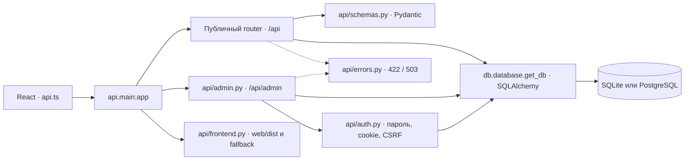
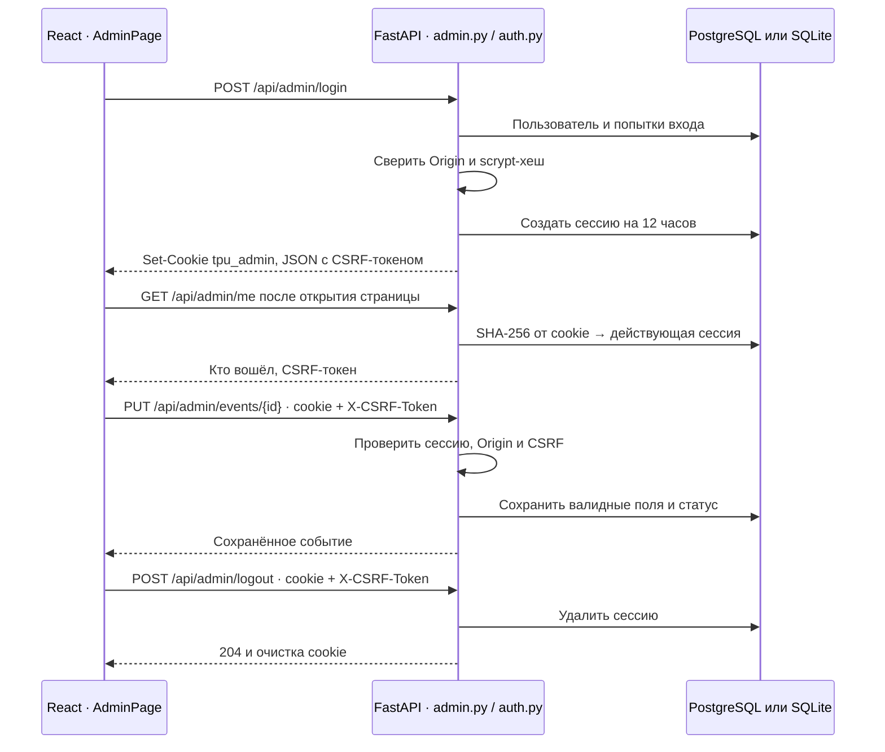

# API календаря мероприятий

FastAPI принимает запросы сайта к `/api/*`. Интерактивная документация локально доступна на [`/docs`](http://127.0.0.1:8000/docs), схема — на [`/openapi.json`](http://127.0.0.1:8000/openapi.json). Представления одного события описаны в [event_format.md](event_format.md).

## 1. Место API в системе



Оба роутера работают с общей базой и используют одну SQLAlchemy-сессию на запрос. Обработчики FastAPI и OpenAPI регистрируются до маршрута раздачи SPA. ВКонтакте опрашивает отдельный [сборщик](collector.md). Путь браузерного запроса и маршруты страниц см. в [карте интерфейса](design.md).

## 2. Публичные запросы

| Метод и адрес | Назначение | Успешный ответ | Ошибки запроса |
|---|---|---|---|
| `GET /api/events` | Лента, поиск, фильтр, календарь | 200, `items`, `page`, `per_page`, `total` | 422 |
| `GET /api/events/{id}` | Детали события | 200, поля ленты плюс `description` и `image_url` | 404, 422 |
| `GET /api/categories` | Категории и число актуальных событий в каждой | 200, массив `slug`, `name`, `events_count` | 503 при недоступной БД |
| `POST /api/submissions` | Заявка организатора | 201, `id` и `status` | 422 |
| `GET /api/health` | Проверка запроса к таблице категорий | 200, `{"status":"ok"}` | 503 при недоступной БД |

Все запросы к БД могут вернуть 503 при `OperationalError`. Успешный `health` подтверждает доступ к таблице `categories`. Готовность остальных частей проверяется сценариями из [инструкции по деплою](deployment.md#6-проверить-релиз).

Параметры `GET /api/events` необязательны.

| Параметр | Правило |
|---|---|
| `category` | Код категории, например `sport`. Неизвестный код даёт пустой массив. |
| `date_from` | Последний день события должен быть в этот день или позже. По умолчанию берётся текущий день в Томске. |
| `date_to` | Первый день события должен быть в этот день или раньше. |
| `q` | Подстрока в названии или описании, без учёта регистра, до 100 символов. Краевые пробелы убираются. |
| `page` | Номер страницы, начиная с 1. По умолчанию 1. |
| `per_page` | Размер страницы 1–100, по умолчанию 20. |

Если `date_from > date_to`, API возвращает 422 на `date_from`. Для календаря за месяц клиент передаёт обе границы, указывает `per_page=100` и загружает остальные страницы до `total`.

## 3. Какие мероприятия видны

Базовый фильтр публичного API требует `status=published`, дату начала и категорию. В ленту попадают события, чей последний день (`COALESCE(end_date, event_date)`) приходится на `date_from` или позже. Если граница отсутствует, используется текущий день по Томску (UTC+7). Параметр `date_to` ограничивает день начала сверху. Так событие с 29 ноября по 2 декабря попадает в запросы календаря за оба месяца.

| Запись | Лента без явных дат | Детали по ID | Счётчик категории |
|---|---|---|---|
| Опубликована, ещё идёт или предстоит | Да | Да | Да |
| Опубликована, завершилась | Появится при подходящем явном `date_from` | Да | Нет |
| `pending`, `rejected`, без даты или категории | Нет | 404 | Нет |

Лента сортируется по дате начала, затем по времени начала, затем по ID. Записи без времени идут в конце дня. Счётчики строятся по всем актуальным событиям базовой ленты. Поиск и фильтры браузера их не пересчитывают.

## 4. Ответы

Пример страницы ленты есть в [event_format.md](event_format.md#пример-записи-в-ответе-api). Типы ответа — `EventShort` для элементов ленты и `EventDetail` для карточки. Даты приходят в ISO-формате `YYYY-MM-DD`, время — `HH:MM`, неизвестные значения — `null`. Поля `category.slug` и `category.name` берутся из справочника. Контакт автора доступен через приватный API админки.

Категории возвращаются в порядке ID, включая категории без событий. Фрагмент ответа:

```json
[
  { "slug": "sport", "name": "Спорт", "events_count": 2 },
  { "slug": "science", "name": "Наука", "events_count": 0 }
]
```

## 5. Заявка из формы

`POST /api/submissions` принимает JSON. Дата в примере должна быть не раньше текущего дня в Томске в момент отправки.

```json
{
  "title": "Субботник «Чистый берег»",
  "organizer": "Волонтёрский центр ТПУ",
  "contact": "volunteers@example.com",
  "category": "volunteering",
  "event_date": "2026-12-06",
  "start_time": "11:00",
  "end_time": "14:00",
  "location": "Набережная реки Ушайки",
  "original_post_link": "",
  "description": "Берём перчатки и мешки, чай после уборки."
}
```

Ответ 201 — `{"id":12,"status":"pending"}`. Событие создаётся с `source=form` и без `post_id`.

- Обязательны `title` (3–300 символов), `organizer` (2–200), `contact` (3–200), существующий `category` и `event_date`.
- Необязательны `end_date`, `start_time`, `end_time`, `location` (до 300), `original_post_link` (до 300), `description` (до 5000). Пустые или пробельные строки в необязательных полях сохраняются как `null`.
- `event_date` не раньше сегодняшнего дня. `end_date` не раньше `event_date`. Для одного дня при наличии обоих значений `end_time` позже `start_time`.
- `original_post_link` принимает HTTP(S) на `vk.com`, `vk.ru` и их варианты `www.` и `m.`. Валидатор проверяет схему и имя хоста.

## 6. Ошибки

422 содержит список проблем. Последний элемент `loc` указывает поле, а первый обычно задаёт источник (`body`, `query`, `path`). Валидатор возвращает только `loc`, `msg` и `type`, без отправленных пользователем значений.

```json
{
  "detail": [
    { "loc": ["body", "event_date"], "msg": "Дата мероприятия уже прошла", "type": "value_error" }
  ]
}
```

Проверки Pydantic выполняются до обработчика маршрута. Поэтому сообщения о прошедшей дате или неизвестной категории могут прийти после исправления остальных ошибок формы. Для 401, 403, 404, 429 и 503 `detail` является строкой. Обработчик 503 в [api/errors.py](../api/errors.py) записывает в серверный лог метод и путь запроса.

## 7. Подключение фронтенда

[web/src/api.ts](../web/src/api.ts) использует относительные URL `/api/*`. Во время разработки Vite проксирует их на `http://127.0.0.1:8000`. Указать другой адрес можно через `API_PROXY_TARGET` в `web/.env`. Для прямых запросов к FastAPI доступен `CORS_ORIGINS` со списком адресов через запятую. Значения по умолчанию — `http://localhost:5173` и `http://127.0.0.1:5173`. Админка использует same-origin запросы с cookie.

На Vercel публичные страницы и API работают на одном домене. При локальной раздаче без сборки FastAPI перенаправляет `/` на OpenAPI UI по адресу `/docs`. При готовой сборке прямые ссылки на страницы открывают SPA. См. [раздачу в production](deployment.md#4-настроить-проект-vercel).

## Админка (ФТ-12)

| Метод и адрес | Что отправить | Успешный ответ |
|---|---|---|
| `POST /api/admin/login` | JSON `username`, `password` | 200, `username`, `csrf_token`, установка cookie `tpu_admin` |
| `GET /api/admin/me` | Cookie | 200, `username`, `csrf_token` |
| `GET /api/admin/events?status=pending&page=1` | Cookie. Статусы `pending`, `published`, `rejected`, `all`. | 200, `items`, `total`, `page`. По 20 записей, новые первыми. |
| `PUT /api/admin/events/{id}` | Cookie, `X-CSRF-Token` и JSON редактируемых полей | 200, сохранённое событие |
| `POST /api/admin/logout` | Cookie и `X-CSRF-Token` | 204, сессия и cookie удалены |



- Cookie имеет `HttpOnly`, `SameSite=Lax`, путь `/api/admin` и срок 12 часов. Атрибут `Secure` включён в Vercel и при `COOKIE_SECURE=1`. Хеш cookie и срок хранятся в БД. React хранит CSRF-токен в памяти и восстанавливает его через `/me`. Ответы с сессией и данными очереди помечены `Cache-Control: no-store`.
- Ошибка входа или отсутствие действующей сессии возвращают 401. После пяти неверных попыток на нормализованный логин дальнейшие запросы входа получают 429 до конца 15-минутного окна. Вход и изменения проверяют совпадение `Origin`, если заголовок передан. Защищённые запросы на запись требуют корректный `X-CSRF-Token`, иначе 403.
- `PUT` задаёт полный набор редактируемых полей — `title`, `organizer`, `category` (slug), `event_date`, `end_date`, `start_time`, `end_time`, `location`, `original_post_link`, `description`, `status`. Обязательны `title`, `organizer` и `status`. Пропущенное необязательное поле записывается как `null`. Источник, контакт и изображение сохраняются.
- Для `published` обязательны дата и существующая категория. В админке разрешено редактировать прошедшие мероприятия. В приватном ответе есть `status` и `contact`, а дата и категория могут быть `null`. Схема таблиц и порядок создания администратора описаны в [db_schema.md](db_schema.md).

Реализация — [api/admin.py](../api/admin.py), [api/auth.py](../api/auth.py). Контракт проверяют [tests/test_api.py](../tests/test_api.py) и [tests/test_admin.py](../tests/test_admin.py).
