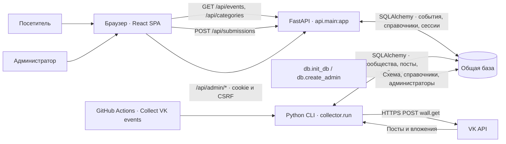
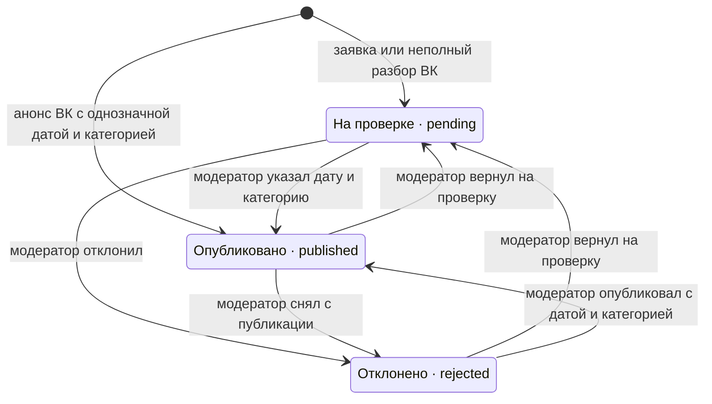
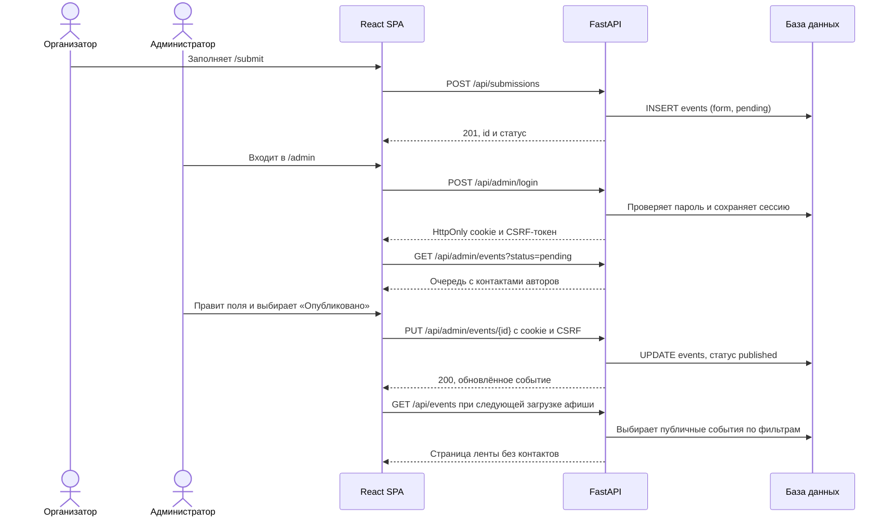

# Архитектура календаря ТПУ

Календарь объединяет анонсы из ВКонтакте и заявки от организаторов. Посетители открывают афишу, календарь и карточки мероприятий. Администраторы проверяют заявки и правят результаты автоматического разбора.

## Системная карта

Граница между сайтом и сборщиком проходит через базу. Сборщик запускается отдельным процессом и пишет события в те же таблицы, из которых FastAPI читает афишу. Браузер вызывает относительные URL `/api/*`. При открытии карточки он может загрузить изображение по внешнему URL, а по кнопке «Подробнее» перейти в ВК. Доступ к `wall.get` нужен только сборщику.

## Стек и точки входа

| Слой | Стек | Точка входа и основной результат |
|---|---|---|
| Браузер | React 19, React Router 7, TypeScript 5.9, Lucide, CSS, Vite 8 и Node.js 22.x | [web/src/main.tsx](../web/src/main.tsx) монтирует SPA. Vite собирает `web/dist`. [Карта интерфейса](design.md) |
| HTTP API | Python 3.12, FastAPI, Pydantic, Uvicorn для локального ASGI-сервера | [api/main.py](../api/main.py) регистрирует публичный и административный роутеры, обработчики ошибок и раздачу SPA. [Контракт API](api.md) |
| Данные | SQLAlchemy, SQLite локально, PostgreSQL через psycopg2 в Neon | [db/database.py](../db/database.py) создаёт engine и фабрику сессий. [db/models.py](../db/models.py) задаёт семь таблиц. [ER-диаграмма](db_schema.md) |
| Сбор | Python 3.12, HTTPX, правила разбора текста и дат | [collector/run.py](../collector/run.py) записывает посты и события. [Карта сборщика](collector.md) |
| Хостинг | Vercel FastAPI Function и CDN, Neon PostgreSQL, GitHub Actions | [vercel.json](../vercel.json), [pyproject.toml](../pyproject.toml), [workflow сборщика](../.github/workflows/collector.yml). [Карта деплоя](deployment.md) |
| Проверки | Pytest, Ruff, Vitest, Testing Library, ESLint, Stylelint, pip-audit, npm audit | [Checks](../.github/workflows/checks.yml) запускает проверки и проверяет чистую production-сборку. Данные для оценки парсера лежат в [data/](../data/README.md) |

Версии зависимостей закреплены в [pyproject.toml](../pyproject.toml), [uv.lock](../uv.lock), [requirements.txt](../requirements.txt) и [web/package-lock.json](../web/package-lock.json).

## Жизненный цикл мероприятия

Админка ещё позволяет править запись с сохранением её текущего статуса. Публичное API требует `published`, дату и категорию. Афиша дополнительно отсеивает события с прошедшим последним днём. Публикация завершившегося события сохраняет возможность открыть его по прямой ссылке и найти в календаре за соответствующий месяц. Условия отбора подробно описаны в [контракте API](api.md#3-какие-мероприятия-видны).

## Сквозной сценарий заявки

## Где смотреть при изменении

- **Поля события и фильтры** — [формат события](event_format.md), [модели БД](../db/models.py), [схемы API](../api/schemas.py), [типы клиента](../web/src/api.ts). Публикация и модерация проверяются в `tests/test_api.py` и `tests/test_admin.py`.
- **Источники и парсер** — [список сообществ](communities.md), [карта сборщика](collector.md), `tests/test_collector.py`, `tests/test_parser.py`, [оценка на выборке](extraction_check.md).
- **Маршруты и страницы** — [карта интерфейса](design.md), [раздача SPA](../api/frontend.py), `tests/test_frontend.py` и `web/src/*.test.*`.
- **Зависимости и релиз** — [порядок развёртывания](deployment.md), [проверка runtime](../scripts/check_runtime.py) и [проверка пакета](../scripts/check_deployment.py).
