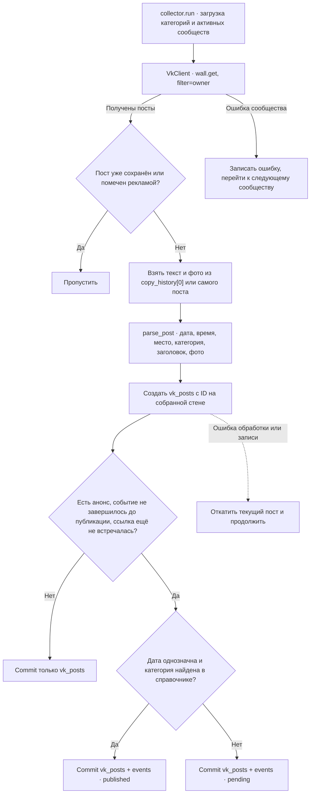

# Карта сборщика ВКонтакте

Сборщик работает как отдельный Python CLI. Он читает активные источники из БД, получает свежие посты через `wall.get`, разбирает их и пишет в общую с сайтом базу. У результата обработки есть две сущности — полученный пост и, если найден анонс, мероприятие.

## Путь поста



## Модули и правила

- [vk_client.py](../collector/vk_client.py) посылает HTTPS POST с `VK_TOKEN` в теле запроса, с интервалом минимум 0,34 секунды между запросами и тайм-аутом 15 секунд. Для ответов VK с кодами 6 и 10 предусмотрено до трёх попыток всего. Другие ошибки передаются наверх. Лимит выше 100 включает постраничную загрузку с `offset`, до 100 постов за запрос.
- [run.py](../collector/run.py) задаёт порядок обработки и транзакции. Посты дедуплицируются по паре `community_id + vk_post_id`. Проверка `original_post_link` предотвращает создание второго события по тому же исходному посту или репосту. Закреплённый пост проходит обычный разбор. Повторный проход пропускает уже сохранённые посты, включая изменённые авторами.
- [dates.py](../collector/dates.py) собирает кандидаты даты из текста. Учитывает явные даты, диапазоны и относительные дни от даты публикации по Томску. Контекст «Когда», «Дата», «состоится» повышает вес кандидата, а признаки дедлайна и исторических дат отстраняют ложные варианты. Близкие по весу разные даты делают результат спорным. Для времени приоритет у строки первого упоминания выбранной даты, затем поиск идёт по следующим строкам и по тексту. Время с пометкой МСК переводится на томские часы (+4).
- [extract.py](../collector/extract.py) очищает разметку ВК, извлекает заголовок, берёт самую крупную фотографию, ищет место в реквизитах и по фразам адреса. Категория определяется по словам и подсказке сообщества. Для поста без даты нужен признак приглашения и отсутствие признаков отчёта. Пост об уже завершившемся на момент публикации событии остаётся без мероприятия.
- [evaluate.py](../collector/evaluate.py) сравнивает собранные поля с [reference_50.csv](../data/reference_50.csv). Выводит количество верных, пропущенных, ошибочных и лишних значений, а также результат правила автопубликации. Текущий прогон и прежние замеры описаны в [отчёте по разбору](extraction_check.md).

Для репоста текст, картинка и ссылка берутся из исходного поста. Время публикации, название организатора и профиль категории опираются на запись и сообщество, из которого сборщик получил репост.

## Режимы запуска

```bash
python -m db.init_db
python -m collector.run --limit 50
python -m collector.evaluate
python -m pytest tests/test_collector.py tests/test_parser.py tests/test_evaluate.py
```

У команды сбора диапазон `--limit` от 1 до 1000 на сообщество, по умолчанию 50. Для ручного и планового запуска GitHub Actions используется один workflow. Ошибка поста откатывает только его транзакцию. При ошибках постов, недоступных сообществах или отсутствии активных источников CLI завершает проход с кодом 1. Лог содержит общую статистику, предупреждения об ошибках и ID проблемных постов или сообществ. [Расписание и эксплуатация](deployment.md#5-настроить-сбор-в-github-actions)

Исходные 15 сообществ перечислены в [communities.md](communities.md). Активность конкретного источника определяется по `vk_communities.is_active` в используемой базе.
