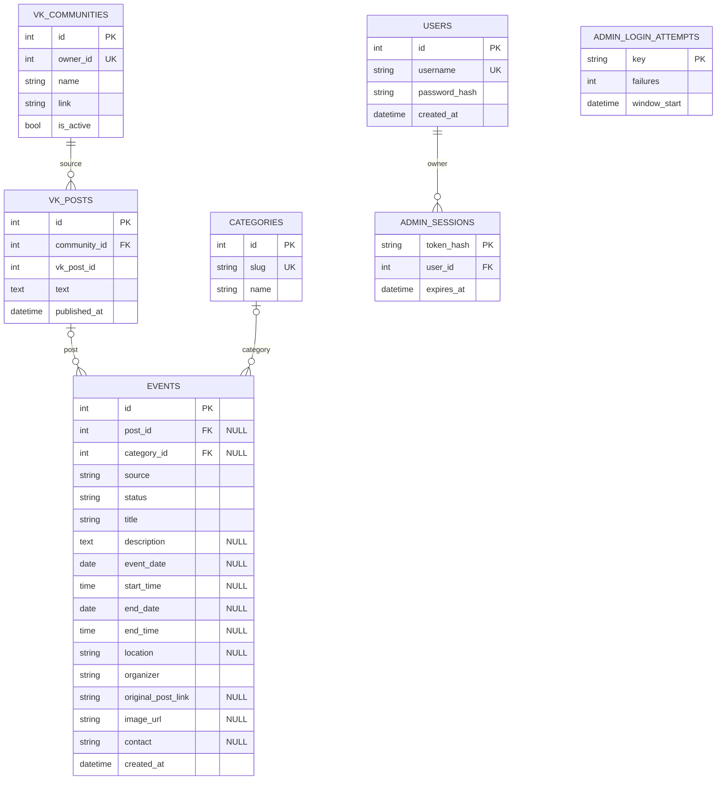

# База данных

[db/models.py](../db/models.py) — схема SQLAlchemy для API и сборщика. Локальный режим использует SQLite. Vercel и ежедневный сбор используют общую PostgreSQL в Neon. Подключение описано в [db/database.py](../db/database.py).

## ER-диаграмма

Связи показывают ограничения базы. `NULL` отмечает необязательное поле, `UK` — уникальное значение. У `vk_posts` уникальна **пара** `(community_id, vk_post_id)`.

## Что лежит в таблицах

- `vk_communities` — перечень источников. `owner_id` берётся из VK и для сообществ отрицательный. `is_active` управляет участием в сборе.
- `vk_posts` — ID поста на стене, источник, очищенный текст и время публикации по Томску. Для репоста ID соответствует записи на собранной стене, а текст берётся из исходного поста. Новость или повтор могут остаться в базе без события.
- `categories` — справочник из шести категорий. Клиент использует `slug`, а `events` ссылается на внутренний ID.
- `events` — извлечённый анонс или заявка. Ограничения `CHECK` проверяют `source IN ('vk', 'form')` и `status IN ('pending', 'published', 'rejected')`. Публичный API и операции модерации требуют дату и категорию для публикации. Есть индексы по `category_id`, `status` и `event_date`. `post_id` допускает несколько событий на один пост по схеме, хотя сборщик записывает максимум одно за обработку поста. Дедупликация по `original_post_link` выполняется в коде сборщика.
- `users` — администраторы. Логин нормализуется до нижнего регистра. В базе хранится scrypt-хеш с индивидуальной солью.
- `admin_sessions` — SHA-256 от случайного cookie, владелец и срок действия в UTC. Индексы созданы по `user_id` и `expires_at`. Удаление пользователя каскадно удаляет его сессии.
- `admin_login_attempts` — число ошибок входа и начало окна в UTC. Первичный ключ — SHA-256 от нормализованного логина. Учитываются попытки и для неизвестных логинов, поэтому здесь нет внешнего ключа на `users`.

Контакт автора есть в `events.contact` и приватных ответах админки. Поля `event_date` и `end_date` — календарные дни, а `start_time` и `end_time` — отдельные локальные часы. Публичный JSON и остальные правила см. в [формате события](event_format.md).

## Подключение и транзакции

- `DATABASE_URL` читается при импорте `db.database`. Локально по умолчанию это `sqlite:///calendar.db` относительно рабочей папки. SQLite включает внешние ключи и переопределяет `lower()` для поиска по кириллице.
- В Vercel `VERCEL=1` блокирует запуск без `DATABASE_URL` или с SQLite. Для PostgreSQL обычные URL `postgres://` и `postgresql://` приводятся к драйверу psycopg2. Engine использует `NullPool`, `pool_pre_ping` и тайм-аут подключения 10 секунд. Пул соединений для Neon обычно предоставляет pooled endpoint Neon.
- API получает SQLAlchemy Session через `get_db` на время запроса. Изменения сохраняются явным `commit()`. Коллектор использует одну Session на проход, фиксирует каждую обработанную запись отдельно и откатывает транзакцию сбойного поста.
- Локально и в CI тесты работают с изолированными базами. В PostgreSQL-прогоне именно `TEST_DATABASE_URL` указывает на отдельную тестовую базу, где фикстуры выполняют `drop_all()` и `create_all()`.

## Инициализация и изменения схемы

`python -m db.init_db` создаёт отсутствующие таблицы и добавляет 6 категорий и 15 сообществ. При повторном запуске он обновляет названия и ссылки, сохраняя переключатель `is_active` и имеющиеся записи. Убранные из исходного списка сообщества остаются в уже заполненной базе, пока их отдельно не отключат.

`python -m db.create_admin <логин>` создаёт пользователя с паролем через скрытый ввод. `--reset-password` обновляет пароль, удаляет его сессии и сбрасывает счётчик входа. `python -m db.seed_test` наполняет базу тестовыми событиями, если таблица `events` пуста. Этот сценарий предназначен для локальной и отдельной тестовой базы.

`create_all()` создаёт новые таблицы. Изменения в существующих столбцах, индексах и ограничениях требуют отдельной миграции. Порядок подключения к Neon и настройки окружений описан в [инструкции по деплою](deployment.md).
