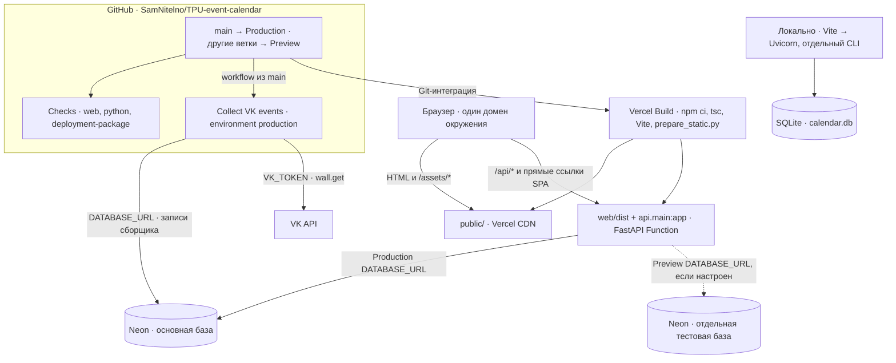

# Развёртывание и эксплуатация

Production-домен проекта — [tpu-event-calendar.vercel.app](https://tpu-event-calendar.vercel.app/). Публичный сайт и API размещаются в одном проекте Vercel. Данные и сессии хранятся в Neon PostgreSQL. Источники ВК обрабатывает GitHub Actions.

На 27.11.2026 в `main` находится коммит `e6318af` с исправлением упаковки Python-зависимостей из [PR №4](https://github.com/SamNitelno/TPU-event-calendar/pull/4). GitHub зафиксировал успешные плановые запуски сборщика с 22 по 27 ноября. Доступность HTTP-проверки с текущего рабочего места и состояние настроек Preview на эту дату не подтверждены. [Последний проверенный запуск сборщика](https://github.com/SamNitelno/TPU-event-calendar/actions/runs/45965178877)

## 1. Карта окружений



| Окружение | Код и процессы | Хранилище |
|---|---|---|
| Local | Vite dev/preview и Uvicorn или собранная SPA через Uvicorn. Сборщик можно запустить вручную. | SQLite из корня по умолчанию. PostgreSQL можно выбрать через `DATABASE_URL`. |
| Vercel Production | Git-интеграция с `main`, одна Function FastAPI и статические файлы на CDN. GitHub Actions использует environment `production`. | Основная база Neon. Vercel и сборщик направлены в одну и ту же базу. |
| Vercel Preview | Сборка ветки или PR в стандартном окружении Preview. | Отдельная база Neon со своими данными и учётными записями приложения. |
| GitHub Checks | Проверки PR и push в `main`. | Изолированные SQLite и временный PostgreSQL 16. |

Ветки Git хранят версии кода. Ветки Neon хранят схему и данные PostgreSQL. Их связывает значение `DATABASE_URL` для выбранного окружения. [Окружения Vercel](https://vercel.com/docs/deployments/environments) · [Ветки Neon](https://neon.com/docs/manage/branches)

## 2. Подготовить Neon

1. В [Neon Console](https://console.neon.tech) выберите существующий проект или создайте новый. Код ждёт PostgreSQL. У Vercel Function регион Frankfurt (`fra1`), поэтому при создании новой базы подходит Frankfurt в Neon.
2. Откройте **Connect**, выберите основную ветку, базу и роль. Для Vercel используйте pooled Connection string. У такого подключения в хосте есть `-pooler`.
3. Скопируйте URL целиком, включая параметры TLS, которые показывает Neon. Для `DATABASE_URL` нужен только URL, без команды `psql` и окружающих кавычек. Строка содержит пароль, поэтому передавайте её через секреты. [Подключение к Neon](https://neon.com/docs/connect/connect-from-any-app)

**Для Preview** создайте отдельную ветку в **Branches → New branch → Schema only** или пустой проект Neon. Для постоянного Preview проверьте настройку срока жизни ветки. `Schema only` переносит структуру без мероприятий, пользователей и сессий приложения. Для доступа используйте отдельные учётные данные БД, а после инициализации заведите администратора Preview с отдельным паролем. [Настройка веток Neon](https://neon.com/docs/manage/branches)

## 3. Инициализировать БД и создать администратора

Откройте PowerShell в корне репозитория. Для первого запуска создайте окружение Python 3.12 и установите зависимости.

```powershell
py -3.12 -m venv .venv
.\.venv\Scripts\python.exe -m pip install --require-hashes -r requirements.txt
```

Выполняйте команды в одном окне PowerShell. Вставьте URL Neon **после** появления приглашения `Read-Host`.

```powershell
$calendarDatabaseSecret = Read-Host 'Вставьте Connection string нужной базы Neon' -AsSecureString
$env:DATABASE_URL = [System.Net.NetworkCredential]::new('', $calendarDatabaseSecret).Password
.\.venv\Scripts\python.exe -c "from db.database import engine; print(engine.dialect.name)"
```

Ожидаемый вывод — `postgresql`. Если видите `sqlite`, сначала исправьте переменную. Проверка подтверждает тип базы. Ветку и имя базы сверяйте в **Connect** перед копированием адреса.

```powershell
.\.venv\Scripts\python.exe -m db.init_db
.\.venv\Scripts\python.exe -m db.create_admin calendar-admin
```

`db.init_db` создаёт отсутствующие таблицы и заполняет справочники. `calendar-admin` — пример логина. Команда скрыто запрашивает и подтверждает пароль длиной 12–1024 символа. Для добавления администратора в существующую базу достаточно проверить подключение и выполнить `db.create_admin` с новым логином. Для смены пароля добавьте `--reset-password`. Это завершит его активные сессии и сбросит счётчик неудачных входов. Vercel увидит изменения базы сразу после фиксации транзакции. [Устройство БД](db_schema.md)

После работы откройте новое окно для локальных команд или удалите временные переменные из текущего.

```powershell
Remove-Item Env:DATABASE_URL
Remove-Variable calendarDatabaseSecret
```

Тестовое наполнение `db.seed_test` запускайте только в локальной или отдельной тестовой базе.

## 4. Настроить проект Vercel

1. При развёртывании с нуля импортируйте `SamNitelno/TPU-event-calendar` через [импорт проекта](https://vercel.com/new). Выберите **Framework Preset → FastAPI** и корень `./`.
2. В настройках Git убедитесь, что Production отслеживает `main`. Node.js — 22.x, Python 3.12 закреплён в `.python-version`. В `vercel.json` задан регион функций Frankfurt и лимит 30 секунд для `api/main.py`. [Интеграция Git и Vercel](https://vercel.com/docs/git)
3. Используйте команду сборки из `vercel.json` и стандартную установку Python runtime. Оставьте Output Directory в автоматическом режиме.
4. В **Settings → Environment Variables** добавьте `DATABASE_URL` в **Production**. Для **Preview** задайте адрес отдельной инициализированной базы. После смены переменных сделайте новый deploy для нужного окружения. [Переменные Vercel](https://vercel.com/docs/environment-variables)

Команда сборки из репозитория:

```bash
npm --prefix web ci && npm --prefix web run build && python scripts/prepare_static.py
```

`npm --prefix web run build` сначала проверяет типы через TypeScript, затем генерирует `web/dist`. [prepare_static.py](../scripts/prepare_static.py) копирует результат в `public/` для CDN. `web/dist` остаётся в пакете FastAPI для прямых переходов на `/calendar`, `/event/:id`, `/submit`, `/guide`, `/admin`. Хешированные `/assets/*` получают `Cache-Control: public, max-age=31536000, immutable`, а HTML — `no-cache`. Отсутствующие файлы и неизвестные GET-адреса API при наличии сборки возвращают 404. [Конфигурация Vercel](../vercel.json) · [Раздача SPA](../api/frontend.py) · [FastAPI на Vercel](https://vercel.com/docs/frameworks/backend/fastapi)

Точка входа Vercel — `api.main:app` в `[tool.vercel]`. Production-зависимости перечислены в `[project.dependencies]` файла `pyproject.toml` и закреплены в `uv.lock`. `requirements.txt` используют сборщик и установка через pip, `requirements-dev.txt` добавляет тесты и линтеры. При изменении Python-зависимостей синхронизируйте манифест, lock-файл и requirements. [Python runtime Vercel](https://vercel.com/docs/functions/runtimes/python) · [Проверка зависимостей](../scripts/check_runtime.py)

## 5. Настроить сбор в GitHub Actions

1. В GitHub откройте **Settings → Environments → production**. В **Environment secrets** нужны `DATABASE_URL` основной базы Neon и `VK_TOKEN` для `wall.get`. Production environment должен допускать выполнение сборщика из основной ветки без ручного ожидания для каждого планового запуска.
2. Для ручной проверки откройте [Collect VK events](https://github.com/SamNitelno/TPU-event-calendar/actions/workflows/collector.yml), нажмите **Run workflow**, выберите `main` и укажите `50`. Результат и статистику смотрите в шаге **Collect posts into production database**.
3. В `collector.yml` указано `17 0 * * *`, то есть ежедневный запуск в **00:17 UTC / 07:17 по Томску**. GitHub запускает расписание из ветки по умолчанию и может сдвинуть время старта. Ручной диапазон — 1–1000 постов на сообщество, лимит задания — 20 минут. Группа `production-vk-collector` предотвращает одновременное выполнение, текущий запуск новый запрос не отменяет. [Workflow проекта](../.github/workflows/collector.yml) · [Расписание GitHub Actions](https://docs.github.com/en/actions/reference/workflows-and-actions/events-that-trigger-workflows#schedule)

При первом наполнении лимит 200 означал до 3000 постов и дошёл до тайм-аута. Для повторной проверки используйте обычный лимит 50. Сохранённые транзакции переживают сбой или отмену. API подхватывает новые записи при чтении из базы, без повторного деплоя. [Запуск с лимитом 200](https://github.com/SamNitelno/TPU-event-calendar/actions/runs/43892491075) · [Обработка ошибок сборщика](collector.md)

### Переменные окружения

| Переменная | Где задаётся | Назначение |
|---|---|---|
| `DATABASE_URL` | Vercel Production/Preview, GitHub environment `production`, локально в shell или корневом `.env` | Подключение к выбранной БД. Локальный fallback — `sqlite:///calendar.db`. |
| `VK_TOKEN`, `VK_API_VERSION` | Только процесс сборщика. Токен — GitHub environment secret или локальный `.env`. | Ключ и версия VK API. В workflow версия `5.199`. |
| `VERCEL` | Vercel выставляет системную переменную. | Значение `1` включает требование PostgreSQL и Secure для cookie. |
| `COOKIE_SECURE` | Необязательно для локального HTTPS. | Значение `1` задаёт Secure-cookie при локальном запуске. |
| `CORS_ORIGINS` | Необязательно на стороне FastAPI. | Список origin через запятую для прямых запросов в API. Встроенные значения — dev-адреса на порту 5173. |
| `WEB_DIST_DIR` | Необязательно на стороне FastAPI. | Переопределяет папку SPA, по умолчанию `web/dist`. |
| `API_PROXY_TARGET` | Локально в `web/.env` или shell Vite. | Цель прокси dev/preview, по умолчанию `http://127.0.0.1:8000`. |
| `TEST_DATABASE_URL` | Тестовое окружение Pytest. | Только отдельная временная PostgreSQL. Тесты создают и удаляют схему этой базы. |

## 6. Проверить релиз

### Что проверяет CI

- `web` — установка из lock-файла на Node.js 22, линтеры, Vitest, сборка, npm audit и артефакт `frontend-build`.
- `python` — Python 3.12, Ruff, Pytest на SQLite и PostgreSQL 16, pip-audit.
- `deployment-package` — чистая установка `uv sync --locked --no-dev`, скачивание уже собранного фронтенда, подготовка `public/`, проверка совпадения runtime-версий, импорта приложения, HTML для маршрутов SPA, кеширования и ответов 404/401. Проверка пакета использует тестовый клиент и проверяет упаковку. Доступность базы на хостинге подтверждает отдельный запрос `/api/health`. [Checks](../.github/workflows/checks.yml)

### Что проверить после размещения

1. В **Vercel → Deployments** сопоставьте source commit с ожидаемым коммитом. Откройте [`/api/health`](https://tpu-event-calendar.vercel.app/api/health) и убедитесь, что ответ HTTP 200 с `{"status":"ok"}`.
2. Откройте `/`, `/calendar` и прямую ссылку на существующее мероприятие. Проверьте поиск, категорию и отображение на узком экране.
3. Для проверки записи используйте Preview. Отправьте тестовую заявку, войдите в `/admin`, откройте её в очереди, исправьте поля, опубликуйте, проверьте появление в афише и затем отклоните. После выхода защищённый `/api/admin/me` должен вернуть 401.
4. Проверьте последние плановые запуски в GitHub Actions и статистику сбора. Сам факт готовой сборки Vercel говорит о коде сайта, а успешный workflow подтверждает проход сборщика.

## Диагностика

| Симптом | Что проверить |
|---|---|
| `ModuleNotFoundError: No module named 'dotenv'` | Проверьте source commit, `[project.dependencies]`, `uv.lock` и job `deployment-package`. [Исправление в PR №4](https://github.com/SamNitelno/TPU-event-calendar/pull/4) |
| `Vercel requires a PostgreSQL DATABASE_URL` | Проверьте переменную нужного окружения. После изменения выполните новый deploy. |
| `/api/health` отдаёт 503 | Проверьте адрес, TLS, роль и доступность Neon. Убедитесь, что `db.init_db` выполнялся для этой базы. |
| Категории видны, а афиша пуста | Проверьте workflow и статусы в админке. Лента показывает опубликованные события с датой и категорией, которые ещё идут или начнутся. |
| Workflow отменён спустя 20 минут | Проверьте лимит и время выполнения. Для обычного сбора используйте 50 постов на сообщество. |
| В админку не войти или ответ 429 | Сверьте базу, в которой создан пользователь. После пяти неверных попыток действует блокировка до конца 15-минутного окна. |
| Админка возвращает 403 при сохранении | Откройте админку на домене нужного окружения и обновите страницу для получения CSRF-токена. |
| Нужен откат | В Vercel выберите предыдущий успешный deployment. Он меняет версию приложения. Восстановление данных и изменение схемы выполняются отдельно в Neon. |
