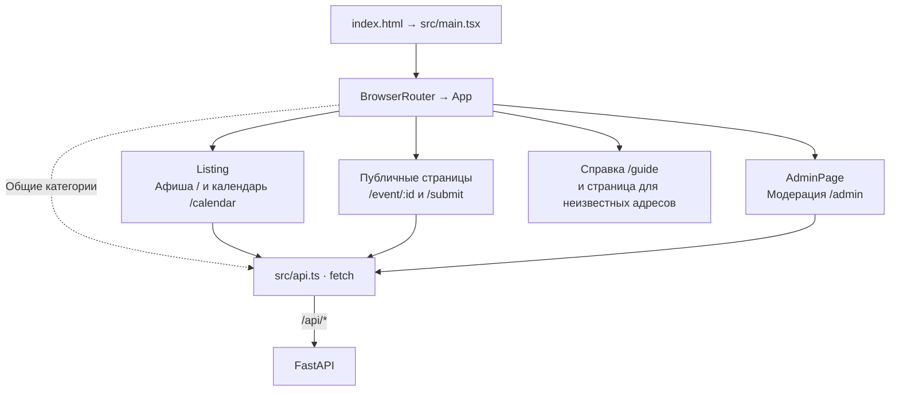

# Карта фронтенда

Интерфейс состоит из React SPA, клиентского роутера, общего HTTP-клиента и CSS. [Интерактивный макет](https://event-calendar-tpu.poehali.ws/) служит визуальным референсом. Запущенный интерфейс использует поля и коды категорий из [FastAPI](api.md).

## Экраны и управление состоянием

| Маршрут | Компонент | Данные и поведение |
|---|---|---|
| `/` | `Listing` → `Feed` | `GET /api/events`, 20 записей на страницу. Группировка по дню. «Показать ещё» добавляет следующую страницу, отсекая повторные ID. Событие, которое уже началось и ещё идёт, группируется под первым видимым днём. |
| `/calendar` | `Listing` → `MonthCalendar` | Тот же API с включительными границами месяца. Клиент запрашивает страницы по 100 до исчерпания результата, раскладывает многодневные события по всем дням диапазона и показывает карточки выбранного дня. |
| `/event/:id` | `EventPage` | `GET /api/events/{id}`. Полное описание и изображение приходят с деталями события. Ссылка и изображение отображаются при валидном HTTP(S) URL. |
| `/submit` | `SubmitPage` | Категории берутся из общего запроса. Форма отправляет `POST /api/submissions`, при 422 показывает ошибки у полей, при 201 показывает номер заявки. |
| `/guide` | `Guide` | Статическая справка о поиске, календаре и подаче заявок. |
| `/admin` | `AdminPage` | При открытии проверяет `GET /api/admin/me`. После входа загружает очередь по статусу, показывает поля события и отправляет решение через `PUT /api/admin/events/{id}`. Успешное сохранение обновляет очередь и счётчики категорий. |

Параметры `q`, `category`, `day` и `month` хранятся в URL для навигации и прямых ссылок. В календаре `day` выбирает день открытого месяца. В ленте `day` передаёт одинаковые `date_from` и `date_to`. Переключение месяца сбрасывает выбранный день.

## Модули

- [src/main.tsx](../web/src/main.tsx) монтирует приложение в `#root`, подключает `BrowserRouter` и импортирует стили.
- [src/App.tsx](../web/src/App.tsx) содержит маршруты, навигацию, публичные экраны и общий запрос категорий. Категории используются из API по `slug`. Подписи «Сегодня» и «Завтра» обновляются по календарю Томска.
- [src/dates.ts](../web/src/dates.ts) определяет текущий день через `Asia/Tomsk` и обрабатывает строки `YYYY-MM-DD` как календарные дни. Это сохраняет дату мероприятия при открытии сайта в другом часовом поясе.
- [src/api.ts](../web/src/api.ts) задаёт типы ответов и отправляет относительные запросы через `fetch` с cookie текущего origin. Тайм-аут — 15 секунд. Экран отменяет устаревшие чтения, а клиент превращает `detail` с полевыми ошибками в словарь для формы.
- [src/AdminPage.tsx](../web/src/AdminPage.tsx) хранит полученный CSRF-токен в состоянии React. Вход восстанавливается запросом `/me` с браузерным HttpOnly cookie.
- [static/style.css](../web/static/style.css) содержит адаптивные стили, Manrope и Unbounded с системными запасными шрифтами, видимый фокус и настройки `prefers-reduced-motion`. Шрифты подключены в [index.html](../web/index.html).

## Как запрос доходит до API

- Локальный Vite слушает `127.0.0.1:5173`, preview сборки — `127.0.0.1:4173`. Оба проксируют `/api` в `http://127.0.0.1:8000` по умолчанию. Другую цель можно указать в `web/.env` через `API_PROXY_TARGET`. [Конфигурация Vite](../web/vite.config.ts)
- После `npm run build` браузер загружает HTML и файлы `assets/` из сборки. FastAPI обрабатывает прямые переходы по адресам SPA и запросы API. В Vercel также есть корневая копия сборки `public/` для CDN. [Схема деплоя](deployment.md)
- Команды разработки и тестов собраны в [web/README.md](../web/README.md). Поведение проверяют `App.test.tsx`, `AdminPage.test.tsx`, `api.test.ts`, `dates.test.ts` и серверный `tests/test_frontend.py`.
